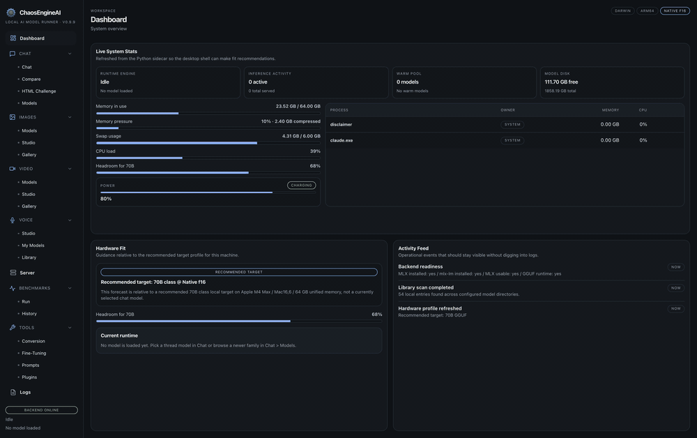
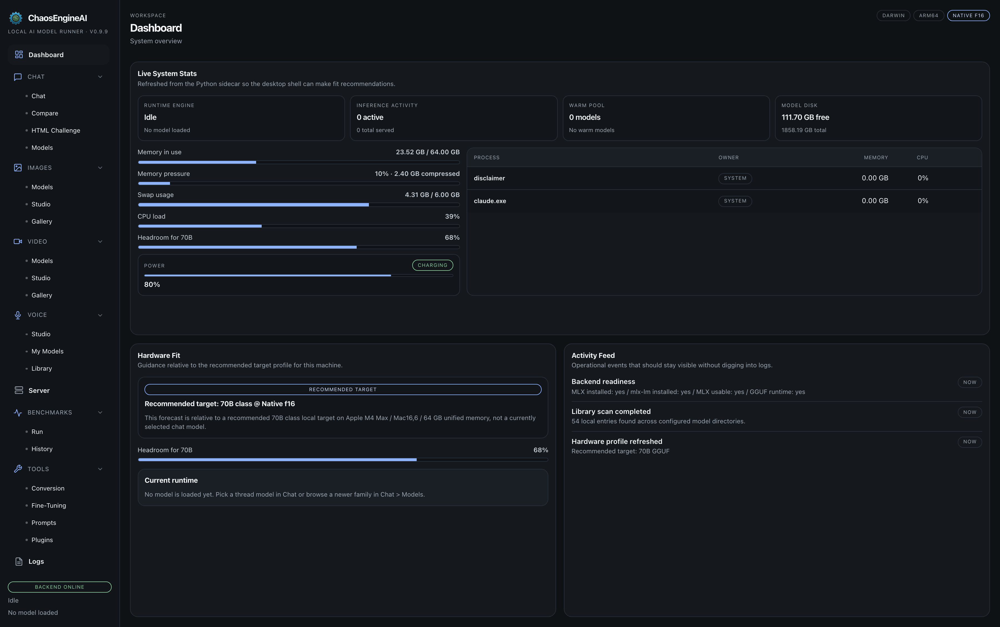
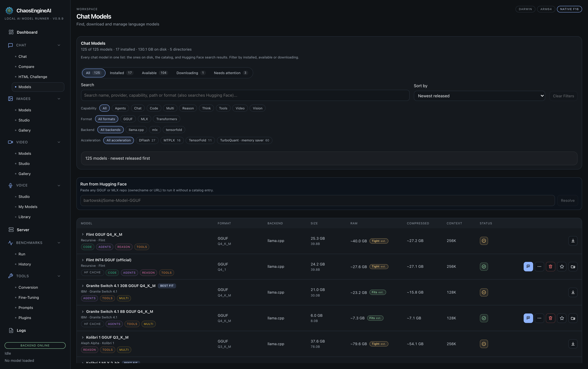
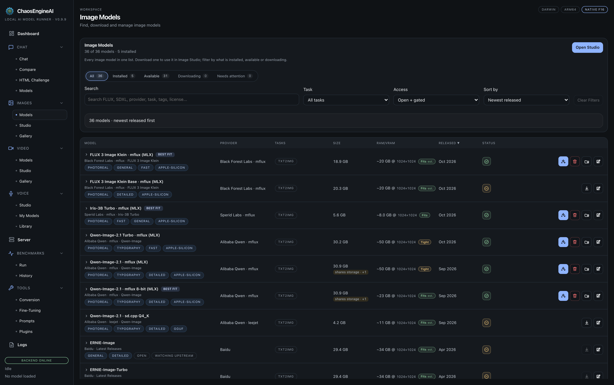
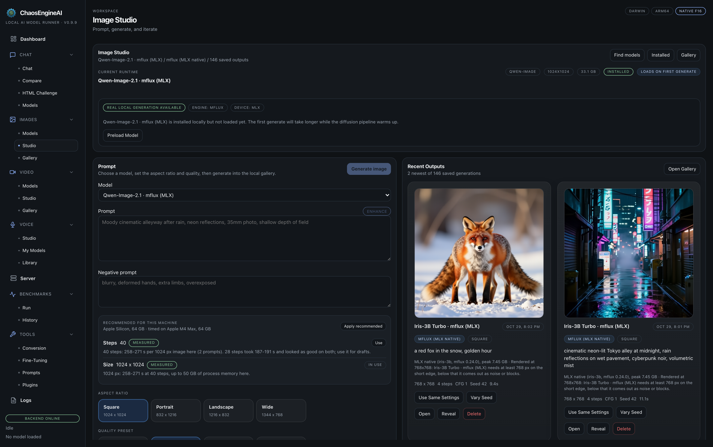
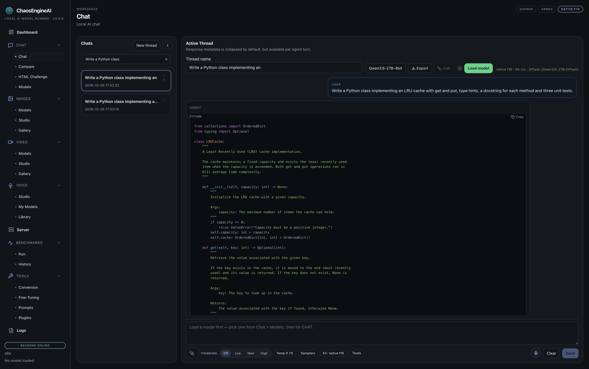
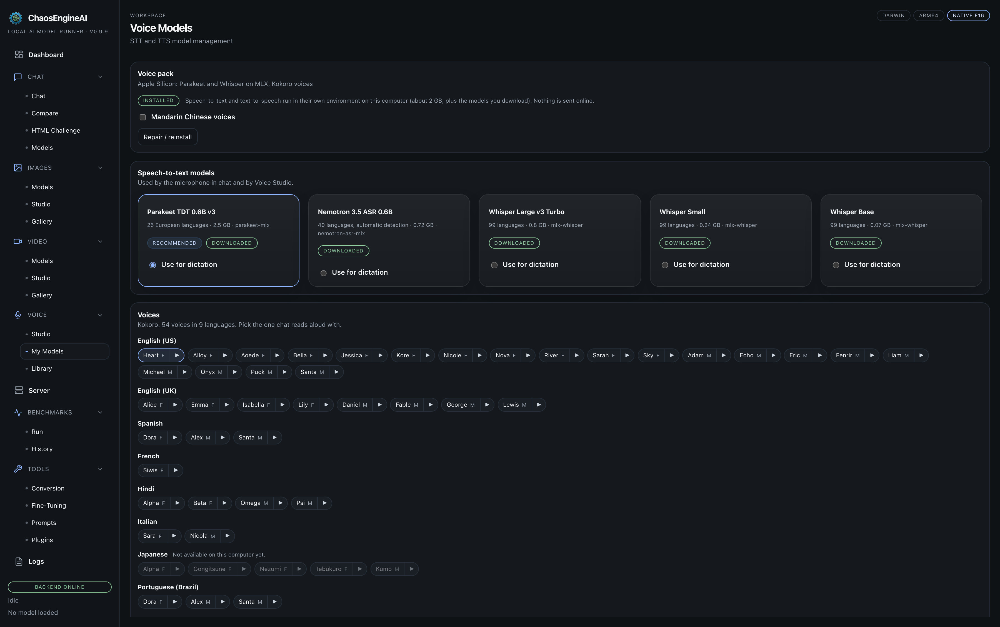

<p align="center">
  
</p>

<h1 align="center">ChaosEngineAI</h1>

<p align="center">
  <strong>The local AI model runner for serious tinkerers.</strong><br/>
  Find, download, convert, serve, chat and talk with, benchmark, and generate images, video and speech from open-weight models — all on your own machine.
</p>

<p align="center">
  
  
  
  
  
  
</p>

> ⚠️ **Work in progress.** ChaosEngineAI is under active development. Expect rough edges, breaking changes between versions, and features that appear (and occasionally disappear) from one release to the next. Feedback and issue reports are very welcome.

<p align="center">
  
</p>

---

## Why ChaosEngineAI

ChaosEngineAI is a desktop control plane for running large language models locally. It pairs a fast Tauri + React shell with a Python backend that drives `llama.cpp`, Apple MLX, and (optionally) vLLM, so you get a single window for everything from "I want to try this Hugging Face model" to "show me tokens-per-second across three quantizations on this exact prompt."

- **One app, the whole pipeline.** Find models, download them, convert to MLX, load into a warm pool, serve over an OpenAI-compatible API, chat (by typing or by voice), benchmark, and generate images, video and speech.
- **Real local performance.** First-class support for `llama.cpp` GGUF and Apple Silicon MLX for LLMs, plus local Stable Diffusion for image generation, plus diffusion DiT video models: LTX-2.3 and LTX-2.5 with sound on Apple Silicon through their own MLX engine (ltx-2-mlx), and Wan 2.1/2.2, LTX-Video, HunyuanVideo, CogVideoX and Mochi via diffusers, mlx-video, and stable-diffusion.cpp scaffolding for cross-platform.
- **Pluggable cache compression.** Native f16 cache out of the box, with KV cache compression strategies — [TriAttention](https://github.com/WeianMao/triattention) and [TurboQuant](https://pypi.org/project/turboquant-mlx-full/), a memory saver for contexts that would not otherwise fit. Install supported backends into the repo-local runtime, restart, and they appear in the UI.
- **Speculative decoding.** DFlash, DDTree, MTPLX, and TensorFold speed up generation without changing what the model would have said. A small draft model proposes tokens; the target verifies them in one forward pass. Gains are largest on code and reasoning replies (about 1.4 to 2 times on Apple Silicon); creative writing can run slower, so leave it off for stories. DDTree extends this with tree-structured candidate exploration for even higher acceptance rates. MTPLX adds native Multi-Token Prediction for models that were trained with MTP heads (Qwen3.5/3.6, DeepSeek V3/R1, Qwen3-Coder-Next).
- **Hybrid local + remote workflows.** Scan multiple local model directories, convert Hugging Face checkpoints to MLX, or point the app at remote OpenAI-compatible providers when you want a cloud fallback.
- **Per-chat runtime profiles.** Each chat session remembers the exact model, cache strategy, quantization bits, context length, and speculative decoding settings used — switch between configurations without losing track.
- **Prompting + evaluation.** Built-in prompt templates, side-by-side compare mode, and benchmark modes for throughput, perplexity, and task accuracy keep experimentation in one place.
- **Agent tools.** Built-in web search, calculator, code executor, and file reader tools that models can call during conversations.
- **Voice, all on your machine.** Dictate into the chat box, have replies read aloud, or press Call and talk to the model out loud; transcribe recordings with speaker labels in Voice Studio. Nothing is uploaded.
- **Knows what your machine can run.** Every model row says whether it fits (Fits, Tight, Won't fit), marks each family's best fit, and the Image and Video Studios suggest settings for your hardware.
- **Built for power users.** Live runtime telemetry, structured logs, side-by-side benchmark history with model filtering and red/green delta comparisons, and granular launch preferences.
- **Polished, fast UI.** A focused dark workspace that gets out of the way and never blocks on the backend.
- **Self-updating.** Ships with a signed in-app updater — no more manual re-downloads when a new release drops.

---

## Feature Highlights

- 🧭 **Models** page for each of Chat, Images and Video: the curated catalog, what is already on disk, and Hugging Face search in one list; filter by Installed, Available, Downloading or Needs attention, and pull a model with one click
- 🎯 **Best fit for your hardware** — Fits / Tight / Won't fit chips on every row (estimates are marked as estimates) and a "Best fit" ribbon on the newest model of each family that fits comfortably
- 🔁 **Conversion** pipeline that turns Hugging Face checkpoints into MLX (Apple Silicon)
- 🚀 **Server** mode exposing an OpenAI-compatible REST API for your other tools
- 💬 **Chat** with the loaded model, by typing or by voice, including document attachments with inline citations, image inputs for vision-capable models, tool calls, collapsible reasoning traces, conversation branching, in-thread compare, mid-thread model swap, and retry on failed turns
- ⚖️ **Compare mode** to stream the same prompt through two models side-by-side with separate runtime settings and metrics
- 🧪 **HTML Challenge** — side-by-side HTML generation across 2-4 models with per-slot thinking mode, reasoning effort, and seed; sandboxed live previews, automated HTML validation, persistent history, retry + repair flows
- 🧰 **Sampler controls** in the composer — `top_p`, `top_k`, `min_p`, `repeat_penalty`, `seed`, `mirostat`, `reasoning_effort`, JSON-schema constrained output
- 🧷 **MCP client** — stdio JSON-RPC tool adapter so any local MCP server is callable from chat
- 📚 **Workspace knowledge stacks** — shared RAG corpus across sessions via `llama-embedding` + cosine retrieval
- 🗂️ **Prompt Library** with built-in starter templates plus searchable tags, categories, CRUD, fill-form variables, and one-click apply-to-chat
- 🖼️ **Image Models** page: every image model, installed or not, with its size, memory need on your machine, and one-click download
- 🖌️ **Image Studio** for prompt-based image generation with aspect ratio, quality presets, and negative prompts, plus a "Recommended for this machine" panel (steps, size, each tagged Measured or Estimated) you can apply in one click
- 📐 **Bigger images** — each model has its own size limit instead of a fixed 2048 px (FLUX.2 and Qwen-Image-2.1 up to 4096), and the memory check accounts for pixels
- 🏛️ **Image Gallery** to browse, filter, and reuse saved outputs — compare models and re-run with the same settings
- 🎬 **Video Studio** for prompt-based video generation across LTX-2.3 and LTX-2.5 (with sound, Apple Silicon), Wan 2.1/2.2, LTX-Video, HunyuanVideo, CogVideoX, and Mochi — with model picker, runtime status overlay, live progress, recommended settings for your machine, and cancellable generation
- 🍿 **Video Models** page with the curated set of diffusion DiT video models and one-click downloads
- 🔊 **Sound on LTX clips** (Apple Silicon): LTX-2.3 and LTX-2.5 write stereo sound that follows your prompt; clips with sound carry a Sound badge and play with sound
- 🎙️ **Voice** — dictation (microphone button in the chat box), read-aloud on every reply, voice calls in Chat (talk, interrupt, every turn saved in the thread), and **Voice Studio** to transcribe recordings and files with speaker labels, translation to English, a click-a-word transcript editor, and TXT / Markdown / SRT / VTT / JSON export, plus text to speech saved as WAV or MP3
- 🗃️ **Voice Library** keeping every recording, transcript and generated clip (old Gallery items move over the first time you open it)
- ⚡ **First Block Cache + TaylorSeer / MagCache / PyramidAttentionBroadcast / FasterCache** cross-platform diffusion cache hooks (≈1.8× FLUX.1-dev with imperceptible drift), plus TeaCache for FLUX / HunyuanVideo / LTX-Video / CogVideoX / Mochi
- 🖼️ **Live denoise thumbnails** in Image + Video Studio via TAESD/TAEHV preview VAE swap — see what's being generated in real time, not just a progress bar
- ✨ **MLX prompt enhancer** (Apple Silicon) — local Qwen2.5-0.5B rewrites your prompt into the active DiT's training distribution per family (FLUX / Wan / LTX / HunyuanVideo / SDXL / SD3)
- 🧬 **Distill LoRA + transformer support** — Hyper-SD-8step / Turbo-Alpha for FLUX.1-dev, CausVid for Wan 2.1, lightx2v 4-step distill for Wan 2.2 A14B I2V (bf16 + fp8_e4m3)
- 🎯 **Wan 2.1 / 2.2 mlx-video runtime** on Apple Silicon — one-shot convert pipeline, GUI install panel, runtime routing for the Wan 2.1 and Wan 2.2 A14B repos
- 🩺 **Diagnostics panel** in Settings — per-section error fallback, platform-aware repair actions, and a one-click reinstall for the Apple Silicon mlx-video runtime
- 📊 **Benchmarks** with throughput, perplexity, and task-accuracy modes plus a history view for A/B comparisons
- 📜 **Logs** streaming straight from the Python runtime
- ⚙️ **Settings** for data directories, Hugging Face tokens, remote providers, integrations, default launch preferences, and runtime tuning
- 🔍 **UI scale** — segmented 75% / 100% / 125% / 150% control in Settings → Display, applied app-wide via `useUiScale`
- ☁️ **Remote providers** for OpenAI-compatible APIs, with keys stored locally and masked in the UI
- 📁 **Model directories** for custom stores or shared model folders
- 🧠 **Warm pool** keeps recently-used models hot so subsequent loads are instant
- 🔄 **In-app updates** — signed, verified, cross-platform. Launch, prompt, relaunch.
- 🍎 **Notarized macOS builds** with a fully embedded, hardened-runtime Python runtime
- 🐧 **AppImage + .deb** for Linux, **NSIS installer** for Windows
- 🎚️ **Adaptive runtime controls** for balancing speed, memory footprint, and quality on local hardware
- 📈 **Live telemetry** on the dashboard: backend health, engine, loaded model, hardware, warm-pool state
- 🔮 **DFlash speculative decoding** for faster code and reasoning replies without changing the output (Qwen3, Qwen3.5, LLaMA 3.1, gpt-oss, Kimi families); on Apple Silicon Qwen3-4B runs at about 113 tokens per second against 53 plain, and NVIDIA's Nemotron 3.5 Bolt GGUF downloads with its own drafter (about 62 to about 160 tokens per second on an M4 Max)
- 🌳 **DDTree** tree-based speculative decoding — explores multiple draft paths in parallel (models made of plain attention layers; hybrid models such as Qwen3.5 and 3.6 run linear DFlash)
- 🪄 **MTPLX** Multi-Token Prediction speculative decoding (Apple Silicon) — 1.8-2.2× speedup with zero quality loss for trained-with-MTP models (Qwen3.5/3.6, DeepSeek V3/R1, Qwen3-Coder-Next, Youssofal MTPLX-Optimized variants)
- 🧵 **TensorFold** exact speculative decoding (Apple Silicon) — every draft is verified against the target, so replies match serial decoding; also the only runtime for architectures stock MLX cannot load (Qwen3.8 Flash Next, GLM-5.3-Flash, DeepSeek-V4-Flash, Ternary Bonsai 2)
- 🔧 **Agent tools** — web search, calculator, code executor, and file reader for tool-augmented conversations
- 🎓 **Fine-tuning** with LoRA adapter support for MLX models
- 🧩 **Plugin system** with 5 extension types: cache strategies, inference engines, tools, model sources, and post-processors
- 🔌 **Integrations** with copy-paste connection snippets for Continue.dev, Goose, Cursor, and Claude Code via the local API

---

## Complete Feature Map

### Local runtimes & serving

- `llama.cpp` GGUF, Apple MLX, optional vLLM, plus remote OpenAI-compatible providers as fallbacks
- OpenAI-compatible local server with preferred port, optional LAN exposure, auto-start, live request counts, active connections, and copyable curl test commands
- Warm-pool activation so recently used runtime profiles can be re-activated instantly
- Signed in-app updates and bundled desktop runtimes for release builds

### Chat, prompting & agent workflows

- Multi-thread chat with pinned sessions, persistent history, inline thread renaming, and per-thread runtime memory
- Conversation branching — fork from any assistant message into a sibling thread
- In-thread compare — render sibling variants side-by-side under the assistant bubble
- Mid-thread model swap with one-turn override (try a different model for a single response, then revert)
- Retry failed assistant turns with one click, against the active runtime profile
- Document uploads with chunked retrieval, inline citations, and per-session document management
- Workspace knowledge stacks: shared RAG corpus across sessions via `llama-embedding` + cosine retrieval
- Image attachments for vision-capable models, with composer auto-gating from typed capability declarations
- Optional thinking mode with collapsible reasoning traces and cleanup of raw reasoning tokens
- Logprobs visualization (advanced-mode gated): per-message confidence summary, MLX logprobs streaming passthrough
- Substrate routing inspector + per-turn host strip surface engine, binary, CPU / GPU / RAM / temperature alongside tok/s and TTFT
- KV strategy chip in composer for per-turn cache override (native / turboquant / triattention) without touching launch settings
- Delve mode — critic-pass on assistant messages
- Tool-augmented conversations with `web_search`, `calculator`, `code_executor`, `file_reader`, plus stdio MCP client (JSON-RPC) so any local MCP server is callable from chat. Tool results render as table / code / markdown / image based on the returned shape.
- Side-by-side compare mode that streams the same prompt through two models with independent runtime settings and metrics
- HTML Challenge — 2-4 model slots, each with own thinking mode + reasoning effort + seed, all answering the same prompt with sandboxed live HTML previews, automated `valid` / `partial` / `script-error` / `blank-render` / `no-html` validation, persistent history, plus retry + repair flows
- OpenAI-compatible local server with full sampler-chain + embeddings parity (`top_p`, `top_k`, `min_p`, `repeat_penalty`, `seed`, `mirostat`, `reasoning_effort`, `json_schema`)
- Prompt Library with built-in starter templates, search, tagging, categories, CRUD, fill-form variables, and one-click apply-to-chat

### Models, discovery & media

- One **Models** page each for Chat, Images and Video: curated catalog, models on disk and Hugging Face search in a single list, filtered by Installed, Available, Downloading or Needs attention (old Discover / My Models links and saved sidebar choices redirect to the right filter)
- Fit badges on every row (Fits, Tight, Won't fit, or Not for this machine), estimates marked as estimates, and a Best fit pick per family: the newest model that fits comfortably
- Multiple local model directories, including custom paths and shared model folders
- Download management with progress, pause / resume, cancel, and a metadata-rich local library; deleting image or video model files asks first and names every model that shares the files; models your machine cannot run are hidden unless already on disk
- Apple Silicon conversion from Hugging Face or local checkpoints to MLX with live progress
- Full local image workflow: Image Models, Image Studio with recommended settings for your machine, Image Gallery, preload/unload controls, seed reuse, saved artifact metadata, and per-model size limits (the fixed 2048 px cap is gone; FLUX.2 and Qwen-Image-2.1 go up to 4096, and a size that does not fit in memory is refused with one that does)
- Full local video workflow: Video Models, Video Studio with prompt enhancer and recommended settings, runtime probe/preload/unload, LTX-2.3 and LTX-2.5 with stereo sound on their own MLX engine (ltx-2-mlx) on Apple Silicon, mlx-video for the LTX-2 dev / distilled rows, diffusers for Wan and the other DiTs, and stable-diffusion.cpp scaffolding for cross-platform
- Hugging Face token management for gated model access

### Models added in v0.9.9

- **Nemotron 3.5 Bolt** (NVIDIA, 4B-effective, for voice and device assistants): the official 6 GB build runs on macOS, Windows and Linux through llama.cpp, with NVIDIA's own DFlash drafter downloaded alongside; ticking speculative decoding takes an M4 Max from about 62 to about 160 tokens per second. An 8-bit build is also listed
- **Granite Switch 4.1** (IBM, Apache 2.0): the 8B and 30B Granite models in one checkpoint with built-in decision and safety adapters; the app runs the chat model
- **LFM3-1.7B** (Liquid AI): small model for agents and tool calling, 256K context, 16 languages; official MLX 4-bit (about 1 GB, about 250 tokens per second on an M4 Max) and GGUF Q4_K_M (1.1 GB, every platform); tool calls work on both
- **Iris-3B Turbo** image model and **Nemotron 3.5** speech recognition (see Image & Video Generation and Voice)
- **LTX-2.5** and **LTX-2.3** video with sound on Apple Silicon, replacing Wan 2.2 TI2V 5B

### Voice

- Install the voice pack once from **Voice > Models** (about 2 GB, plus the models you choose); it lives in its own folder and runs on your computer, nothing is uploaded
- Dictation (microphone button in the chat box), read-aloud on every reply or automatically, and voice calls in Chat: the app hears when you stop, the model answers out loud, you can talk over it to interrupt, and every turn is saved in the thread
- **Voice Studio**: a transcription queue for recordings and audio / video files with speaker labels and translation to English; edit the transcript, click a word to jump to it in the audio, rename speakers, export TXT, Markdown, SRT, VTT or JSON, or send it to a chat. **Speak** turns long text into speech with pauses and voice previews, saved as WAV or MP3
- **Voice Library** keeps every recording, transcript and generated clip
- Apple Silicon: Parakeet (25 European languages, the fastest), Nemotron 3.5 speech recognition (40 languages, detects the language by itself) or Whisper (99 languages) for speech recognition, Kokoro for speech. Windows and Linux: Whisper through faster-whisper and Kokoro. Voice on Windows and Linux is new and has had less testing than on the Mac
- The first time you use the microphone, macOS asks for permission

### Performance, evaluation & extensibility

- DFlash and DDTree speculative decoding with auto-resolved draft models and graceful fallback; GGUF models can use speculative decoding too, and NVIDIA's DFlash drafter downloads with Nemotron 3.5 Bolt
- LLM cache strategies: native f16, TriAttention, TurboQuant
- Diffusion cache strategies — FBCache + TeaCache + TaylorSeer + MagCache + PyramidAttentionBroadcast (PAB) + FasterCache — applied to image + video DiTs (FLUX, SD3.5, Wan2.1/2.2, HunyuanVideo, LTX-Video, CogVideoX, Mochi)
- Runtime controls for cache bits, FP16 layers, fused attention, fit-in-memory behavior, context length, and speculative tree budget
- Benchmark modes for throughput, perplexity, and task accuracy (MMLU / HellaSwag), with persistent history, scatter plots, and diff tables
- LoRA adapter discovery plus fine-tuning hooks for local training workflows
- Plugin system spanning cache strategies, inference engines, tools, model sources, and post-processors
- Live logs, backend health, hardware telemetry, and orphaned-worker cleanup reporting

### Settings & integrations

- Data-directory relocation with migration/copy support
- Remote-provider configs stored locally with masked keys and HTTPS validation
- Integration snippets for Continue.dev, Goose, Cursor, and Claude Code through the local OpenAI-compatible API

---

## A Tour of the App

### Dashboard — *System overview*


The launchpad. Surfaces backend health, the engine in use, the currently loaded model, hardware (platform, arch, memory), and quick stats from the warm pool. Big colored badges tell you instantly whether the runtime is online and what cache mode it will use on the next launch.

### Chat Models — *Find, download and manage language models*


One list for every chat model: the ones on disk, the curated catalog, and Hugging Face search results. Filter by **Installed**, **Available**, **Downloading** or **Needs attention**, and by capability, format, backend and acceleration. Every row carries a fit chip (Fits, Tight, Won't fit; an "est." marks an estimate), a **Best fit** ribbon marks the newest model of a family that fits your machine comfortably. **Run from Hugging Face** takes any GGUF or MLX repo without a catalog entry.

### Model Selection — *Configure and launch*


The launch modal. Pick a variant, set context length, choose the engine, and tune runtime strategy knobs in one place, pre-populated from your defaults.

### Image Models — *Find, download and manage image models*


The same single-list layout for image models: every model in the catalog, with provider, task, size, the memory it needs at 1024 x 1024 and a fit chip. Filter by task and access (open or gated). Deleting model files asks first and names every model that shares them, and **Open Studio** jumps straight to generation.

### Video Models — *Find, download and manage video models*


Video models in the same layout. On this Mac LTX-2.5 distilled q4 (with sound, on its own MLX engine) is the Best fit; the Wan 2.2 rows are the A14B models (Wan 2.2 TI2V 5B is no longer in the catalog).

### Image Studio — *Generate images from text*


Prompt-based image generation with full control. Choose a model, set aspect ratio and quality presets (square, portrait, landscape, wide), write positive and negative prompts, and generate. **Recommended for this machine** suggests steps and size for your hardware, each tagged Measured or Estimated with the reason, and **Apply recommended** sets them in one click. Controls a model's engine ignores are hidden. Recent outputs appear in the right panel with metadata and re-run options.


Live progress while the diffusion pipeline runs — step-by-step denoising visualization, elapsed time, and a running status log.


Completed image with full generation metadata — model, prompt, seed, steps, resolution, and timing. Open, reveal on disk, clone settings, or save directly from the completion modal.

### Video Studio — *Generate video, with sound*


Prompt-based video generation with a model picker, runtime status, and the same **Recommended for this machine** panel (size, frames and fps for your hardware). On Apple Silicon, LTX-2.3 and LTX-2.5 run on their own MLX engine and make stereo sound that follows your prompt; describe the sound too. Sizes are multiples of 64, and the steps, guidance and negative prompt controls are hidden because that pipeline has none. Install the engine from the Video Studio (about 1 GB), then download the model. Clips with sound show a **Sound** badge in the gallery and play with sound in the result window.

### Image Gallery — *Browse and reuse generated images*


All your generated images in one place. Search by prompt, model, or runtime; filter by frame size and sort order. Each card shows the source model, generation settings, and quick actions to re-run with the same seed or open in Image Studio.

### Chat — *Local AI chat*


A focused chat surface with multi-thread sessions in the left rail, pinned threads, document and image attachments, inline citations, tool-call cards, collapsible reasoning traces, and inline thread renaming. Threads persist across launches, remember the model/runtime profile that produced them, and can be reloaded directly from the thread toolbar. The **microphone** button in the composer dictates into the message box, a **speaker** button on every reply reads it aloud (or turn on automatic read-aloud), and **Call** starts a hands-free voice call with the loaded model: it hears when you stop talking, answers out loud, and you can talk over it to interrupt. An (i) next to Call lists anything still missing, and every turn is saved in the thread.

### Voice Studio — *Transcribe and speak*


**Transcribe** takes a recording or any audio or video files (several at once) in a queue, with optional speaker labels and translation to English. The transcript opens beside the audio: click a time or a word to play from there, double-click a line to edit it, rename speakers, then export TXT, Markdown, SRT, VTT or JSON, or send it to a chat. **Speak** turns long text into speech, with pauses and voice previews, saved as WAV or MP3. Everything is kept in the **Voice Library**, which also holds the items from the old Gallery.

### Voice Models — *Speech recognition and voices*


Install the voice pack once (about 2 GB, plus the models you choose; it runs in its own folder on your computer and nothing is sent online), pick the speech-recognition model used for dictation (Parakeet, Nemotron 3.5 and Whisper on Apple Silicon; Whisper through faster-whisper on Windows and Linux), and choose and preview the Kokoro voice that chat reads aloud with. Voice on Windows and Linux is new and has had less testing than on the Mac.

### HTML Challenge — *Side-by-side HTML generation*

Pick 2 → 4 models, configure each slot's thinking mode (`off` / `auto`), reasoning effort (`low` / `medium` / `high`), and seed independently, then issue one prompt. Every slot streams its HTML response in parallel with a sandboxed live preview underneath the raw text — so you see what each model actually rendered, not just what it wrote.

Built-in HTML validation runs per slot (`valid` / `partial` / `script-error` / `blank-render` / `no-html`) and is fed back from the iframe sandbox so script crashes and blank renders surface immediately. Every run is saved to a persistent history with title + prompt + per-slot manifests; re-open earlier runs, delete, or open / reveal individual slot HTML files on disk. Failed slots support retry and a `continue` / `repair` flow that asks the same model to either resume from the partial response or fix its own broken HTML.

### Server — *OpenAI-compatible local API*


Start, stop, and inspect a local OpenAI-compatible HTTP server backed by the loaded model. Shows the bind address, warm-pool entries, request count, active connections, LAN exposure, preferred port, auto-start controls, and a remote-test panel with copyable curl commands for `/health`, `/models`, and `/chat/completions`.

### Benchmarks — *Run a new benchmark*


Configure a benchmark run: choose a model, throughput prompt preset or eval dataset, token budget, and decoding parameters, then watch live progress as the runner streams tokens-per-second, time-to-first-token, memory usage, or eval metrics.


Live progress while a run is in flight — token/sec, TTFT, current prompt, and memory pressure all update in real time.


Final report card: throughput, latency percentiles, generation samples, and the exact run parameters — saved automatically to history.

### History — *Compare saved runs*


Every benchmark you've ever run, side-by-side. Pick two runs and the page diffs them across throughput, latency, and quality metrics — perfect for proving that your new quant actually pays its keep.

### Conversion — *Convert models to MLX format* (macOS only)


Apple Silicon only. Point at a Hugging Face checkpoint or local directory and convert it to MLX with optional runtime-specific compression settings. A conversion picker surfaces eligible source models.


Layer-by-layer live progress while the conversion runs — bit budget per block, memory footprint, and a running log tail.

### Prompt Library — *Reusable system prompts*

Search, create, edit, tag, and delete reusable prompt templates, including five built-in starter personas. Any template can be applied to Chat with one click so you can switch between coding, summarization, translation, and other system-prompt presets without copy-paste.

### Plugins — *Extensions and plugin system*

Inspect built-in and external plugins across cache strategies, inference engines, tools, model sources, and post-processors. Plugins can be enabled or disabled from the UI, and external plugins are discovered from the app's plugin directory.

### Logs — *Runtime events*


A live tail of the backend log stream — load events, server requests, errors, and runtime warnings — with level filtering. The first place to look when something feels off.

### Settings — *Directories and defaults*


Configure model and cache directories, remote-provider fallbacks, Hugging Face tokens for gated models, data-directory migration, integration snippets for external tools, default launch preferences (cache strategy, FP16 layers, fused attention, context tokens, fit-in-memory toggle), and advanced runtime knobs. Every default in this panel is reused as the starting state for the launch modal.

---

## Download & Install

Head to the [Releases](https://github.com/cryptopoly/ChaosEngineAI/releases/latest) page for signed builds:

| Platform | File | Notes |
|---|---|---|
| **macOS** (Apple Silicon) | `ChaosEngineAI_*_aarch64.dmg` | Signed + notarized |
| **Linux** | `ChaosEngineAI_*_amd64.AppImage` | Portable, in-app updates supported |
| **Linux** (Debian/Ubuntu) | `ChaosEngineAI_*_amd64.deb` | Install via `dpkg`, update via apt |
| **Windows** | `ChaosEngineAI_*_x64-setup.exe` | Unsigned for now — SmartScreen will warn on first run |

From v0.4.21 onward, every install auto-updates from GitHub Releases on launch. Updates are cryptographically signed.

---

## Quick Start (from source)

Prereqs: Rust toolchain, Node 20+, Python 3.11+, and (on macOS) Xcode command-line tools.

```bash
# 1. Install JS dependencies

npm install

# 2. Stage the bundled Python runtime + llama.cpp binaries into src-tauri/
npm run stage:runtime

# 3. Launch the desktop app in dev mode (Tauri shell + Vite HMR)
npm run tauri:dev
```

That's it — the Python backend is spawned by the Tauri shell, the React UI hot-reloads, and you can start exploring.

---

## Architecture

ChaosEngineAI is three cooperating layers:

```
┌─────────────────────────────────────────────────────────┐
│  Tauri shell  (Rust)                                    │
│  ├─ React + TypeScript UI  (src/)                       │
│  ├─ In-app updater (signed releases from GitHub)        │
│  └─ Spawns and supervises the Python backend            │
└─────────────────────────────────────────────────────────┘
                          │  HTTP  /  IPC
                          ▼
┌─────────────────────────────────────────────────────────┐
│  Python backend  (backend_service/)                     │
│  ├─ Workspace + library + warm pool state               │
│  ├─ OpenAI-compatible HTTP server                       │
│  ├─ Engine adapters + plugin system                     │
│  └─ DFlash / DDTree speculative decoding                │
└─────────────────────────────────────────────────────────┘
                          │
          ┌───────────────┼───────────────┐
          ▼               ▼               ▼
  ┌──────────────┐ ┌──────────────┐ ┌──────────────┐
  │  llama.cpp   │ │ MLX runtime  │ │   vLLM       │
  │  (GGUF)      │ │ (Apple Si)   │ │ (Linux/CUDA) │
  └──────────────┘ └──────────────┘ └──────────────┘
```

- **`src/`** — React 18 + TypeScript UI. Single-window workspace with a sidebar nav covering LLM, image, video and voice screens.
- **`src-tauri/`** — Tauri 2 Rust shell + bundled runtime.
- **`backend_service/`** — Python service that owns model lifecycle, the warm pool, the OpenAI-compatible API, the benchmark runner, and speculative decoding (DFlash + DDTree).
- **`backend_service/routes/`** — FastAPI routes for chat, prompts, compare mode, benchmarks, plugins, images, server controls, and settings.
- **`cache_compression/`** — Pluggable cache/compression strategy system. Ships with native f16 and optional adapters for [TriAttention](https://github.com/WeianMao/triattention) and [TurboQuant](https://pypi.org/project/turboquant-mlx-full/).
- **`dflash/`** — DFlash speculative decoding integration: draft model registry, fuzzy matching for quantized variants, MLX and vLLM backend detection.

---

## Cache Compression Backends

ChaosEngineAI uses a pluggable cache strategy system. Out of the box, models run with the native f16 KV cache (no compression). Install any of the optional backends below and they automatically appear in the **Cache Strategy** selector in the launch modal — no configuration required.

| Backend | Install | Bits | Platforms | Description |
|---|---|---|---|---|
| **Native f16** | Built-in | — | All | Full-precision KV cache. Maximum quality and speed, no compression. The default, and the one speculative decoding works with. |
| **[TriAttention](https://github.com/WeianMao/triattention)** | `./.venv/bin/python3 -m pip install triattention vllm` | 1-4 | Linux + CUDA only (via vLLM) | KV cache compression integrated into vLLM's scheduler. Not supported on macOS (the MLX hook is attached but mlx-lm's generation loop never calls it, so it has no effect there). |
| **[TurboQuant](https://pypi.org/project/turboquant-mlx-full/)** | `./.venv/bin/python3 -m pip install turboquant-mlx-full` (Apple Silicon) or `scripts/build-llama-turbo.sh` (CUDA / Metal via llama.cpp fork) | 1-4 (MLX) / turbo2/3/4 (llama.cpp) | Apple Silicon (MLX), CUDA + Metal (llama.cpp fork) | **Memory saver, not a speed option.** Hadamard / Walsh-Hadamard rotation-based KV cache compression: a much smaller cache for long contexts, at the cost of slower generation (and, on MLX, no chat-history cache reuse and no speculative decoding). The MLX path uses `turboquant-mlx-full` for native MLX caches; the llama.cpp path uses the forked `llama-server-turbo` binary built by `scripts/build-llama-turbo.sh`. |
| **[TeaCache](https://github.com/ali-vilab/TeaCache)** | Built-in (vendored `teacache_forward` patches under `cache_compression/_teacache_patches/`) | n/a (rel_l1_thresh) | Diffusion DiT (FLUX, HunyuanVideo, LTX-Video, CogVideoX, Mochi) | Diffusion-side cache that skips redundant forward passes between adjacent timesteps. Default `rel_l1_thresh=0.4`. |
| **[FBCache](https://github.com/huggingface/diffusers)** | Built-in (diffusers 0.36+ `apply_first_block_cache` hook) | n/a (threshold) | Diffusion DiT (FLUX, SD3.5, Wan, HunyuanVideo, LTX-Video, CogVideoX, Mochi) | Model-agnostic first-block cache for DiTs. Default threshold 0.12. |
| **TaylorSeer** | Built-in (diffusers 0.38+ `TaylorSeerCacheConfig`) | n/a | Diffusion DiT (FLUX, Wan, HunyuanVideo, LTX-Video, CogVideoX, Mochi) | Taylor-series predictor caches skipped forward passes. Surfaced in Image + Video Studio pickers. |
| **MagCache** | Built-in (diffusers 0.38+ `MagCacheConfig`) | n/a | Diffusion DiT (FLUX only without calibration) | Magnitude-aware caching using `FLUX_MAG_RATIOS`. CLI / API only until calibration UX lands. |
| **PyramidAttentionBroadcast (PAB)** | Built-in (diffusers 0.38+ `PyramidAttentionBroadcastConfig`) | n/a | Diffusion DiT | Broadcasts attention across timestep pyramids. Surfaced in Image + Video Studio pickers. |
| **FasterCache** | Built-in (diffusers 0.38+ `FasterCacheConfig`) | n/a | Diffusion DiT | Tight cache windowing for big DiTs. CLI / API only — not surfaced in the picker yet. |

Install optional backends into the backend runtime (`./.venv/bin/python3 -m pip install ...`), then restart ChaosEngineAI. TriAttention is Linux/CUDA only. The TurboQuant MLX path needs `turboquant-mlx-full` from PyPI; the TurboQuant llama.cpp path needs the forked `llama-server-turbo` binary built locally via `scripts/build-llama-turbo.sh`.

> **Removed in FU-030.** ChaosEngine (PCA-based; cryptopoly/ChaosEngine) and RotorQuant (IsoQuant / PlanarQuant rotation) were dropped from the strategy registry. ChaosEngine was eclipsed by KVTC at ICLR 2026 (same PCA approach but 8–32× compression vs 3.7×) and RotorQuant only ever aliased the TurboQuant llama.cpp fork. Persisted user configs that still reference `chaosengine` or `rotorquant` now coerce silently to `turboquant` via `CacheStrategyRegistry.resolve_legacy_id`.

LLM cache strategies are filtered out of the diffusion picker via the `appliesTo` domain field — TeaCache only appears on diffusion models, and the LLM-side strategies only appear in chat. The system is designed so new compression methods can be added as single-file adapters in `cache_compression/` without touching any other code.

---

## Speculative Decoding

ChaosEngineAI ships with three speculative decoding modes that accelerate generation by 1.8-5x with zero quality loss.

### DFlash

A small draft model proposes a block of tokens; the target model verifies them in a single forward pass. Accepted tokens are committed instantly; rejected tokens fall back to standard autoregressive generation.

**Supported model families:** Qwen3 (4B, 8B), Qwen3.5 (4B-35B / 122B-A10B), Qwen3-Coder (4B, 8B), LLaMA 3.1 8B, gpt-oss (20B, 120B), Kimi families (K2.5, K2.6), Gemma-4 (31B, 26B-A4B-it), MiniMax-M2.5 / M2.7.

**Requirements:** Apple Silicon + `dflash-mlx`, or Linux/CUDA + `dflash`. Native f16 cache (no compression). A compatible draft checkpoint is auto-resolved from the [z-lab](https://huggingface.co/z-lab) collection.

### DDTree (Diffusion Draft Tree)

Extends DFlash with tree-structured candidate exploration. Instead of verifying a single draft path, DDTree builds a tree of top-k candidates using a max-probability heap and verifies the entire tree in one forward pass with a tree-structured attention mask. The longest verified path is accepted, yielding higher acceptance rates than linear DFlash.

**Configuration:** Set the **tree budget** slider (0-64) in Runtime Controls when DFlash is enabled. Budget 0 = linear DFlash; higher budgets explore more branches at the cost of additional memory for the attention mask.

DDTree falls back to linear DFlash on failure, and DFlash falls back to standard generation.

### MTPLX (Multi-Token Prediction)

Native MTP speculative decoding for Apple Silicon, powered by the [`mtplx`](https://github.com/youssofal/mtplx) package (Apache 2.0). Instead of pairing a separate draft model with the target, MTPLX uses the target model's own trained MTP heads to propose multiple tokens per forward pass — yielding 1.8-2.2× speedup with zero quality loss on supported models.

**Supported model families:** Qwen3.5, Qwen3.6, DeepSeek V3 / R1, Qwen3-Coder-Next, plus the [Youssofal/MTPLX-Optimized](https://huggingface.co/Youssofal) variants. The full registry lives in `backend_service/inference/_mtp.py` (`MTP_MODEL_MAP` + `_MTP_ALIASES`).

**Install:** One-click "Install MTPLX" button in the Setup tab. Because `mtplx` ships its own forked `mlx` and can't share the main backend `.venv`, the installer provisions an isolated environment at `~/.chaosengine/mtplx-venv/`.

**Routing:** When speculative decoding is enabled and the loaded model has MTP heads, the backend's `_select_engine` auto-routes through MTPLX. If the MTPLX venv is missing or the model is not in the registry, the backend falls back to DFlash, then to standard MLX generation.

### TensorFold (exact speculative decoding)

An optional Apple Silicon engine built on [`TensorFold`](https://github.com/ashhart/TensorFold) (MIT, alpha). It runs a model family with per-family kernels and drafts several tokens per step from the model's own MTP head and, for some families, a small draft model. Every draft is verified against the target model, so the reply is byte-identical to one-token-at-a-time decoding.

**Two roles:** for checkpoints stock MLX also loads (Qwen3.8 27B, Nemotron 3.5 Lightning, Gemma 4) it is an accelerator you switch on with the speculative-decoding toggle. For families `mlx-lm` has no architecture for (Qwen3.8 Flash Next, GLM-5.3-Flash, DeepSeek-V4-Flash, Ternary Bonsai 2) it is the only runtime, so those models always run on it. The registry lives in `backend_service/inference/_tensorfold.py` and matches exact repo ids.

**Install:** One-click "Install TensorFold" in the launch settings or the Setup tab, or `./scripts/chaosengine-cli tensorfold-install`. TensorFold pins its own `mlx` / `mlx-lm` versions, so the installer provisions an isolated environment at `~/.chaosengine/tensorfold-venv/`.

**Routing:** An explicit TensorFold backend, a TensorFold-only model, or a tested checkpoint with speculative decoding on (and TensorFold installed) goes through `TensorFoldEngine`; it outranks MTPLX and DFlash. If it fails to start, models stock MLX can also load fall back to standard MLX. Two optional extras add image input (experimental; `Vontra/Qwen3.8-27B-MLX-4bit`) and structured output (JSON-schema enforcement) from the launch settings or `chaosengine-cli tensorfold-install --extras`. Full details: [docs/features/tensorfold.md](docs/features/tensorfold.md).

---

## Image & Video Generation

ChaosEngineAI includes a full local image and video generation pipeline powered by Hugging Face Diffusers, [mlx-video](https://github.com/Blaizzy/mlx-video) on Apple Silicon, and a [stable-diffusion.cpp](https://github.com/leejet/stable-diffusion.cpp) engine scaffold for cross-platform builds.

### Image models

| Model | Provider | Speed | Resolution |
|---|---|---|---|
| **FLUX.1 Schnell** | Black Forest Labs | ~4s | 1024x1024 |
| **FLUX.1 Dev** | Black Forest Labs | ~7s | 1024x1024 |
| **Stable Diffusion 3.5 Medium** | Stability AI | ~6s | 1024x1024 |
| **SD 3.5 Large Turbo** | Stability AI | ~2s | 1024x1024 |
| **Iris-3B Turbo** (Apple Silicon, mflux) | Sperid Labs | ~18s on an M4 Max, 4 steps, 7.5 GB | 1024x1024; renders at 768 px or more (it raises a smaller size and says so) |

Each model has its own size limit instead of a fixed 2048 px cap (FLUX.2 and Qwen-Image-2.1 go up to 4096), and the memory check accounts for pixels: on a 64 GB Mac FLUX 3 Klein made a 3072 by 3072 image in under two minutes, and 4096 by 4096 is refused with a size that fits. The MLX image engine moves to mflux 0.24; update it from the Image Studio.


### Video models

| Model | Provider | Engine | Notes |
|---|---|---|---|
| **Wan 2.1 T2V 1.3B / 14B** | Alibaba Wan-AI | diffusers (MPS / CUDA) | Text-to-video; 1.3B fits comfortably on a 64 GB Mac |
| **Wan 2.2 A14B** (with the lightx2v 4-step distill) | Alibaba Wan-AI | diffusers | The older Wan 2.2 TI2V 5B models were removed from the catalog |
| **Lightricks LTX-Video** | Lightricks | diffusers | Base LTX-Video; CUDA + MPS paths |
| **Lightricks LTX-2.5 / LTX-2.3 distilled q4** | Lightricks, `dgrauet` MLX packs | ltx-2-mlx (Apple Silicon) | Own MLX engine with stereo sound; LTX-2.5 is the default LTX model and is a gated Hugging Face repo (accept its licence, give your token read access to public gated repos). LTX-2.3 took 155 s for a 4 s 768x512 clip on an M4 Max, LTX-2.5 128 s |
| **Lightricks LTX-2 / LTX-2.3** (distilled + dev) | Lightricks | mlx-video (Apple Silicon) | Subprocess engine via `prince-canuma/LTX-2*` repos |
| **HunyuanVideo** | Tencent | diffusers | TeaCache rescale coefficients vendored |
| **CogVideoX** | Zhipu | diffusers | TeaCache supported |
| **Mochi** | Genmo | diffusers | TeaCache supported |

Find and download models from the **Models** pages under Images and Video, generate from prompts in **Image Studio** or **Video Studio** with aspect ratio, quality presets, negative prompts, prompt enhancer, seed control and recommended settings for your machine, then browse and reuse outputs in **Image Gallery**.

---

## Building a Release

Releases are tag-driven. Push `vX.Y.Z` and the GitHub Actions release workflow builds signed bundles for macOS, Linux, and Windows in parallel, generates the `latest.json` updater manifest, and stages a draft release.

```bash
# locally, if you want to cut a build by hand:

npm run stage:runtime:release
npm run tauri:build
```

Release artifacts land in `src-tauri/target/release/bundle/`.

For an unsigned local macOS app + DMG without Apple signing/notarization or Tauri updater signing configured:

```bash

npm run release:macos -- --skip-sign --skip-notarize
```

That writes the local app + DMG to `releases/macos/`.

---

## Headless Automation — `chaosengine-cli`

Every feature in the desktop app is also reachable from the terminal via `scripts/chaosengine-cli` — a Python 3 wrapper (stdlib only, zero new dependencies) that talks to the same FastAPI backend the Tauri shell uses. It covers 100% of the 125 backend routes through a generic `call <METHOD> <PATH>` dispatcher plus 95 ergonomic typed shortcuts.

**Subcommand categories:** `serve`, `status`, `load`, `unload`, `prompt`, `bench`, `mtplx-install`, `mtplx-status`, `tensorfold-install`, `tensorfold-status`, `image-generate`, `video-generate`, `session-*`, `setup-*`, `diagnostics-*`, and more. JSON is written to stdout, errors to stderr — composable with `jq` or any other pipeline tool.

The backend on port 8876 must be running (either via the Tauri app or `./scripts/chaosengine-cli serve`).

```bash
# Start the backend (or just leave the Tauri app open)
./scripts/chaosengine-cli serve &

# Load a model with speculative decoding
./scripts/chaosengine-cli load Youssofal/Qwen3.6-27B-MTPLX-Optimized-Speed --spec

# Prompt with streaming + per-token metrics
./scripts/chaosengine-cli prompt "Write a Rust quicksort" --max-tokens 256 --stream --metrics

# Benchmark a model with 3 runs
./scripts/chaosengine-cli bench mlx-community/Qwen3.6-35B-A3B-4bit --spec --runs 3
```

Optional PATH symlink so you can call it from anywhere:

```bash
ln -s /Users/dan/ChaosEngineAI/scripts/chaosengine-cli ~/.local/bin/chaosengine-cli
```

**Headless install** (no GUI, no Tauri, no npm, no cargo):

```bash
git clone https://github.com/cryptopoly/ChaosEngineAI.git
cd ChaosEngineAI
python3 -m venv .venv
.venv/bin/pip install -e .
./scripts/chaosengine-cli serve
```

### E2E test suite

`scripts/e2e_test_suite.py` drives the CLI through 8 phases (env probe, chat, compare, HTML challenge, image studio, video studio, setup probes, diagnostics + cleanup) and writes JSON + Markdown reports to `~/.chaosengine/test-results/`. `--smoke` completes in ≤60s; the full sweep finishes in ≤5 min on a warm box. The suite is gated as phase 9 of 9 in `scripts/pre-build-check.sh`. See [`docs/E2E_TESTING.md`](./docs/E2E_TESTING.md) for the full phase-by-phase breakdown.

---

## Project Layout

```
ChaosEngineAI/
├── src/                  React UI (App.tsx is the workspace shell)
├── src-tauri/            Tauri Rust shell + bundled runtime
├── scripts/              Build, release + runtime staging scripts
├── backend_service/      Python backend (engine adapters + HTTP server)
├── cache_compression/    Pluggable cache/compression strategy adapters
├── dflash/               DFlash/DDTree speculative decoding integration
├── tests/                Backend integration tests
├── Screenshots/          UI screenshots used by this README
├── docs/                 Tour GIF + supporting docs
└── ChaosEngineAI_AppIcon.svg
```

---

## License & Credits

ChaosEngineAI is currently distributed under the Apache-2.0 license. See [`LICENSE`](./LICENSE).

See [`THIRD_PARTY_NOTICES.md`](./THIRD_PARTY_NOTICES.md) for optional third-party dependency notes.

Built on the shoulders of [`llama.cpp`](https://github.com/ggerganov/llama.cpp), [Apple MLX](https://github.com/ml-explore/mlx), [Tauri](https://tauri.app/), and the broader open-weights community.
