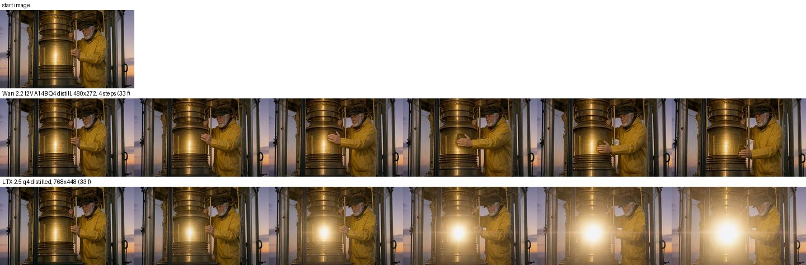
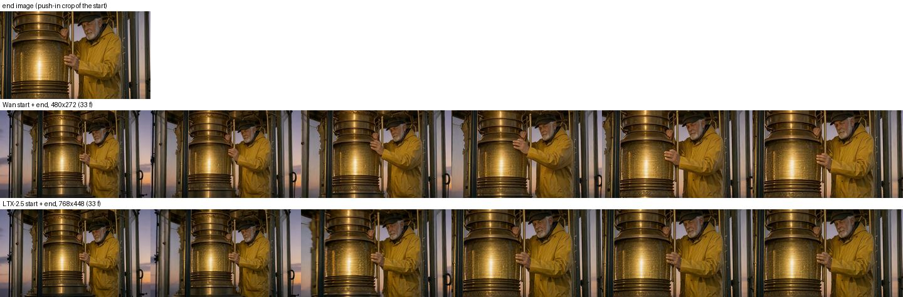
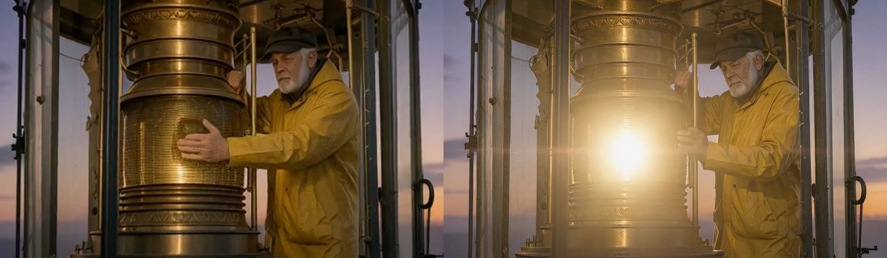

# Wan 2.2 image-to-video against LTX-2.5 on a 64 GB M4 Max

Measured 2026-11-07 for D-48. Machine: MacBook Pro M4 Max, 40-core GPU, 64 GB, macOS 27.3, torch 2.11,
diffusers 0.41. Other agents were running jobs on the same Mac; every run below started only after no other
heavy generation had been seen for 30 s, and ran under a memory guard that kills the process above a cap.

## Verdict

**Wan is slow on this Mac, and the memory is the bigger problem, not the speed.** The owner's memory was right.

- At the size LTX uses for storyboard clips (768 x 448, 33 frames) Wan 2.2 I2V A14B does not fit in 64 GB.
  Unconstrained, the process reached a 135 GB footprint (swap) and was stopped. With every memory trick we
  tried (text encoder dropped, attention split, VAE on the CPU) it still passed 57 GB at the final VAE decode;
  its four denoise steps alone took 8 minutes there (187, 111, 92 and 88 s). LTX-2.5 does the same clip in
  **54 to 58 s at 18.6 GB**.
- At 480 x 272 (a third of the pixels) Wan works: **98 to 114 s per 33-frame clip, 53 to 55 GB peak**. That is
  about 2x LTX's time for a third of the picture, and close to the whole machine's memory.
- Quality and motion are a real point for Wan. On the same still and prompt, Wan's keeper actually wipes the lens
  with his hand; LTX keeps him almost still and turns the prompt's "light flares" into a growing glare. Wan's
  480 x 272 frames hold up well when scaled to LTX's size (frame 20 below), but they are softer, and Wan has no
  sound. Both follow an end image (a push-in) about equally.

So: **on a 64 GB Mac, LTX stays the storyboard default.** Wan is wired and labelled with its measured cost
(480 x 272 recommended on a Mac, about 105 s, 54 GB), so a user who wants Wan's motion can choose it for a
single clip with nothing else loaded. On a CUDA card with 24 GB or more Wan is the stronger image-to-video model
and the start and end frames work there the same way (not run here: no CUDA machine).

## Results

Same start image (lighthouse-keeper `06-lamp` still, 1024 x 576, resized), same prompt ("He wipes the brass
lens in slow circles and the light flares, camera slowly pushes in."), seed 42, 33 frames. End-image runs use a
push-in crop of the start image as the last frame. Wan runs at its 4 distilled steps without guidance, flow-match
Euler (the app's MPS scheduler for Wan); LTX runs the app's distilled two-stage command line.

| Model and size | Run | Wall time | Split | Peak memory |
|---|---|---|---|---|
| LTX-2.5 q4, 768 x 448, start | cold (new process, first run) | 56.6 s | text 5 s, stage 1 (8 steps) about 19 s, stage 2 (3 steps) about 23 s, decode + mux 3.6 s | 18.6 GB footprint |
| | 2, 3 (each a new process; disk cache warm) | 54.0, 58.1 s | same | 18.6 GB |
| LTX-2.5 q4, 768 x 448, start + end | 3 runs | 69.4, 67.4, 72.1 s | | 18.6 GB |
| Wan 2.2 I2V A14B Q4, 480 x 272, start | cold: load 35 s + run 1 | 133 s (load 31.7 s, run 97.8 s) | VAE encode 7 s, steps 26.5 / 18.9 / 19.1 / 19.0 s, VAE decode 14.4 s | 53 to 55 GB |
| | warm 2, 3 | 105.4, 114.2 s | steps about 20 to 22 s | 54.7 GB |
| Wan, 480 x 272, start + end | cold: load 31.5 s + run 1; warm 2 | 98.1 s; 104.3 s | steps 19 to 29 s, decode 15 s | 54.6 GB |
| Wan, 768 x 448, start | 1 (stopped) | did not finish | VAE encode on CPU 77 s, steps 187 / 111 / 92 / 88 s, killed at decode | above 57 GB (cap) |
| Wan, 768 x 448, no memory tricks | 1 (stopped) | did not finish | stopped before step 1 | 135 GB footprint (swapping) |

Peak memory: LTX is `/usr/bin/time -l` "peak memory footprint". Wan is the larger of the MPS driver
allocation (sampled every 0.2 s in the process) and the process footprint (sampled every second); the driver
figure includes the allocator's cache. The Wan process holds 31 GB once loaded (both Q4 experts, about 19 GB,
plus the 11 GB UMT5 text encoder in bf16); the Wan VAE then spikes by up to about 20 GB on MPS, which is what
sets the peak.

The 480 x 272 Wan rows ran with the attention split into 2048-query chunks and the MPS cache freed before each
VAE pass. The app ships the cache release, not the split (see "What shipped"), and its own route was checked
end to end on this branch (backend on port 8894, under the same memory guard at 58 GB): a start + end clip at
480 x 272 x 33 frames with the Studio's default sliders came back in **103 s of generation (136 s including the
model load)**, 4 steps and guidance 1.0 substituted from the row, frames the same as the bench run's.

## Contact sheets

Start image only (six evenly spaced frames):

Start and end image:

Frame 20, Wan (480 x 272 scaled to 768 x 448) on the left, LTX on the right:

Nobody can judge motion from stills and numbers alone; the clips are in the run folder named below and are worth
a look before deciding anything.

## Candidates and why this one

| Build | Size | Start / end | Why not (or why) |
|---|---|---|---|
| **Wan 2.2 I2V A14B, lightx2v 4-step distill, GGUF Q4_K_M** (`jayn7/WAN2.2-I2V_A14B-DISTILL-LIGHTX2V-4STEP-GGUF` @ `338fb8e`, `high_noise/` + `low_noise/` files, 9.66 GB each) with text encoder and VAE from `Wan-AI/Wan2.2-I2V-A14B-Diffusers` @ `596658f` | 31.2 GB | yes / yes | **Benchmarked.** The only build that takes an end frame through the app's diffusers path, and small enough to try on 64 GB. Base licence Apache 2.0; the GGUF repo carries no licence tag (derived from Apache 2.0 `lightx2v/Wan2.2-Distill-Models`). |
| Wan 2.2 I2V A14B bf16 or FP8 distill (the catalog's earlier rows) | 56 / 28 GB of experts plus the 126 GB base download | yes / yes | Two 28 GB experts in memory on MPS (FP8 is upcast); does not fit 64 GB. These rows also needed the full base transformers. |
| Wan 2.2 TI2V 5B (diffusers) | 34 GB | yes / **no** | diffusers ignores `last_image` for it; timed before (FU-122: 293 s for 33 frames at 832 x 480 and 20 steps). |
| MLX Wan (`Anes1032/Wan2.2-I2V-A14B-mlx-q8` 42.7 GB, `Anes1032/Wan2.2-TI2V-5B-mlx-q8` 19.6 GB, via mlx-video) | | yes / **no** | mlx-video takes a start image only. Not downloaded; an MLX speed check stays open (see below). |

## What shipped (branch `feat/wan-i2v`)

- Catalog row `Wan-AI/Wan2.2-I2V-A14B-Diffusers-distill-gguf-q4km`: two GGUF experts (`ggufFile` for the
  high-noise `transformer`, `ggufFile2` for the low-noise `transformer_2`), 4 steps, CFG 1, 480 x 272
  recommended size, 54 GB MPS footprint and about 105 s, measured settings for `apple-64`, 832 x 480 x 81
  frames recommended on CUDA.
- Runtime: `WanImageToVideoPipeline` in the registry; both experts load from GGUF and stay on the GPU (on a Mac
  CPU offload saves nothing and costs a copy per step; CUDA uses model CPU offload); the start and end images go
  in as `image=` and `last_image=` after a centre crop to the clip's shape; the MPS cache is freed before each
  VAE pass.
- One rule for who takes an image (`backend_service/helpers/video_image_input.py`): the video route (Wan without a
  start image is a 400 that says so), Studio (pickers shown, Generate waits for a start image), storyboard clips,
  and the agent bridge listing (Wan is listed but never picked as the default video model).

## Not verified

- CUDA: no CUDA machine here; the Wan path there (model CPU offload, 832 x 480) is untested.
- The attention split was measured but not shipped; a Mac user at sizes above 480 x 272 will hit the memory gate
  (by design) rather than a slow swap.
- MLX Wan ports (mlx-video): not timed. They take a start image only, so they would not give end frames without a
  patch upstream.
- Wan quality at more than one prompt and still: one scene only.

## Reproduce

Run folder (scratch, not committed): `bench/` under the session scratchpad; contact sheets copied to
`docs/research/media/`. Wan: `scripts/bench-wan-i2v.py OUT start.png [--end end.png] --runs 3 --frames 33
--width 480 --height 272` with `ATTN_CHUNK=2048 EMPTY_CACHE=1`. LTX: the app's command line,
`ltx-2-mlx generate --distilled --model <ltx-2.5-mlx-q4 snapshot> --prompt ... -H 448 -W 768 --frames 33
--frame-rate 24 --seed 42 --image start.png 0 1 [--image end.png 32 1]` under `/usr/bin/time -l`, with
`HF_HUB_OFFLINE=1`.
