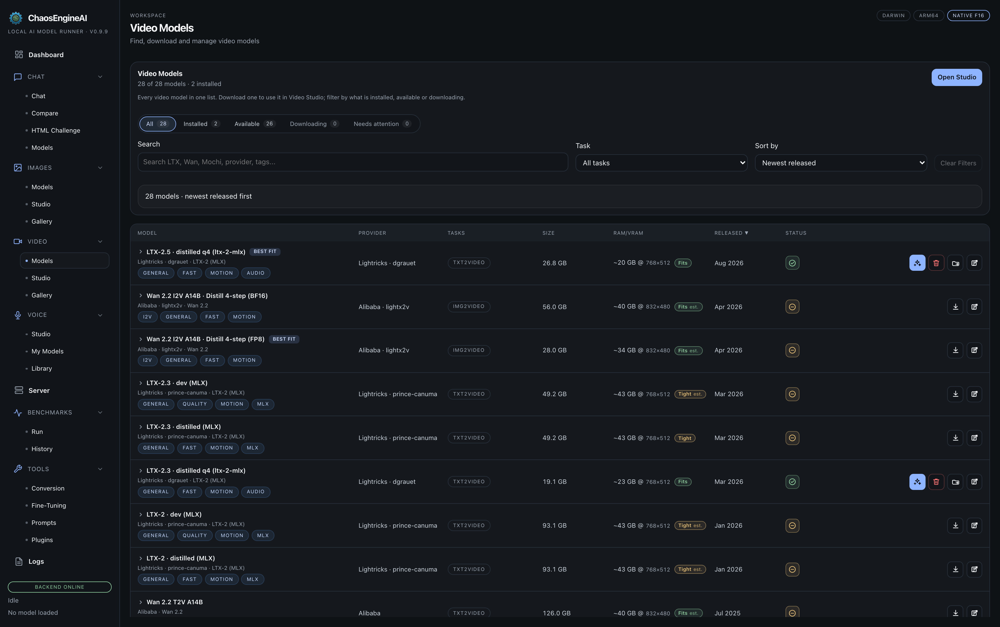
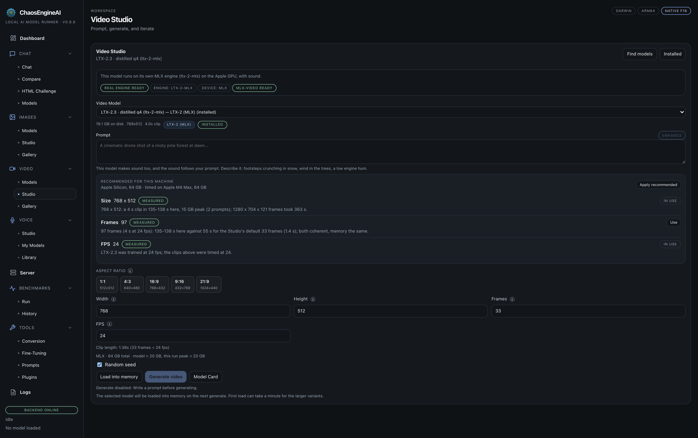

# Video Studio

Video Studio mirrors Image Studio for diffusion-DiT video models. It supports
LTX-2.3 and LTX-2.5 (with sound, on Apple Silicon), Wan 2.1 / 2.2,
Lightricks LTX-Video, HunyuanVideo, CogVideoX, and Mochi via four runtime
paths:

- **ltx-2-mlx** (Apple Silicon) for LTX-2.3 and LTX-2.5, with stereo sound.
- **Diffusers** on MPS (Apple Silicon) or CUDA (Linux + NVIDIA).
- **mlx-video subprocess engine** (Apple Silicon) for LTX-2 and converted
  Wan 2.1 / 2.2 checkpoints — typically 2-5× faster than diffusers on MPS.
- **stable-diffusion.cpp** scaffolding for cross-platform builds.

## Supported models

| Model | Provider | Engine | Notes |
|---|---|---|---|
| **Wan 2.1 T2V 1.3B / 14B** | Alibaba Wan-AI | diffusers (MPS / CUDA) | T2V; 1.3B comfortable on a 64 GB Mac. |
| **LTX-2.5 / LTX-2.3 distilled q4** | Lightricks | ltx-2-mlx (Apple Silicon) | Own MLX engine, stereo sound. LTX-2.5 is the default LTX model. |
| **Wan 2.2 A14B** | Alibaba Wan-AI | diffusers, mlx-video | T2V and I2V. The Wan 2.2 TI2V 5B models were removed from the catalog. |
| **Wan 2.2 A14B I2V × lightx2v 4-step distill** | Alibaba Wan-AI + lightx2v | diffusers | Distilled transformer (bf16 / fp8_e4m3). |
| **LTX-Video 2.0 / 2.3** (distilled + dev) | Lightricks | mlx-video subprocess | `prince-canuma/LTX-2-*` repos. |
| **HunyuanVideo** | Tencent | diffusers | TeaCache rescale coefficients vendored. |
| **CogVideoX** | Zhipu | diffusers | TeaCache supported. |
| **Mochi** | Genmo | diffusers | TeaCache supported. |

The Wan mlx-video path runs through a one-shot convert pipeline that
downloads the raw Hugging Face checkpoint and converts it to mlx-video's
expected weight layout. Use **Setup → Install Wan (Apple Silicon)** to
manage this.

Find and download models from **Video > Models**, which lists every video
model in one place (filter by **Installed**, **Available**, **Downloading** or
**Needs attention**; each row says whether it fits this machine).





## LTX-2.3 and LTX-2.5 with sound (Apple Silicon)

LTX-2.3 and LTX-2.5 run on their own MLX engine and write stereo sound that
follows your prompt, so describe the sound too (footsteps crunching in snow,
wind in the trees, a low engine hum).

- Install the engine from the Video Studio (about 1 GB), then download
  **LTX-2.3 distilled q4** (28 GB, including its text encoder).
- LTX-2.5 is the default LTX model and a gated Hugging Face repo: accept its
  licence on the model page and give your token read access to public gated
  repos, then download it from the Video Studio.
- On an M4 Max a 4-second 768 by 512 clip with sound takes about 2.5 minutes
  with LTX-2.3; the same prompt and seed took 128 seconds with LTX-2.5
  against 155 for LTX-2.3 (17 GB of memory), and looks cleaner.
- Sizes are multiples of 64. The steps, guidance and negative prompt controls
  are hidden because this pipeline has none.
- Clips with sound show a **Sound** badge in the gallery and play with sound
  in the result window.

**Recommended for this machine** (size, frames and fps for your hardware,
each tagged Measured or Estimated, with **Apply recommended**) works here as in
Image Studio.

## Composing a generation

The right rail is shaped like Image Studio but adds video-specific knobs:

- **Frame count** (typical: 16-81 frames).
- **FPS** (typical: 16 / 24 / 30).
- **Resolution.** Per-model defaults; LTX-2 wants 480-720 ranges, Wan 2.1
  T2V 1.3B prefers 480 × 272.
- **CFG decay.** Default on for flow-match video models — linear ramp from
  initial CFG to 1.5 floor.
- **Cache strategy.** FBCache + TeaCache for FLUX-family video; FBCache for
  Wan. Both produce 1.5-2× speedups at imperceptible quality drift.
- **Distill transformer.** Auto-populated for lightx2v Wan 2.2 4-step.
- **FP8 layerwise casting** (CUDA SM 8.9+) — bf16 compute, fp8 storage for
  Wan / HunyuanVideo / FLUX video.

## Live thumbnails

The same TAESD / TAEHV preview-VAE swap that Image Studio uses is wired
into the video pipeline — except video latents are higher-dimensional, so
the helper handles both standard 4D and FLUX's packed 3D latent shapes.
Thumbnails arrive every few steps so you can see whether the motion is
sensible before waiting for full decode.

## mlx-video runtime status

The Wan + LTX path uses subprocess workers, so it has its own status panel
in Settings → Diagnostics:

- **Runtime probe** — checks that `python -m mlx_video.models.<family>.generate`
  imports cleanly.
- **Inventory** — which Wan repos have been converted on disk.
- **Per-repo install / convert** — run from the **Setup → Wan (Apple
  Silicon)** panel.

## Programmatic alternative

```bash
# Catalog
./scripts/chaosengine-cli video-catalog | jq '.entries[].repo'

# Download
./scripts/chaosengine-cli video-download "Wan-AI/Wan2.1-T2V-1.3B"

# Wan-specific install + convert (Apple Silicon)
./scripts/chaosengine-cli wan-install Wan-AI/Wan2.1-T2V-1.3B
./scripts/chaosengine-cli wan-inventory

# Generate
./scripts/chaosengine-cli video-generate "a fox running through a forest at dawn" \
    --model "Wan-AI/Wan2.1-T2V-1.3B" --frames 5 --fps 16 --steps 4 --seed 42

# Watch progress
./scripts/chaosengine-cli video-progress

# Outputs
./scripts/chaosengine-cli video-outputs | jq '.outputs[] | {id, prompt}'
```

See [CLI recipes](../cli/recipes.md) for batch / scripted runs.
