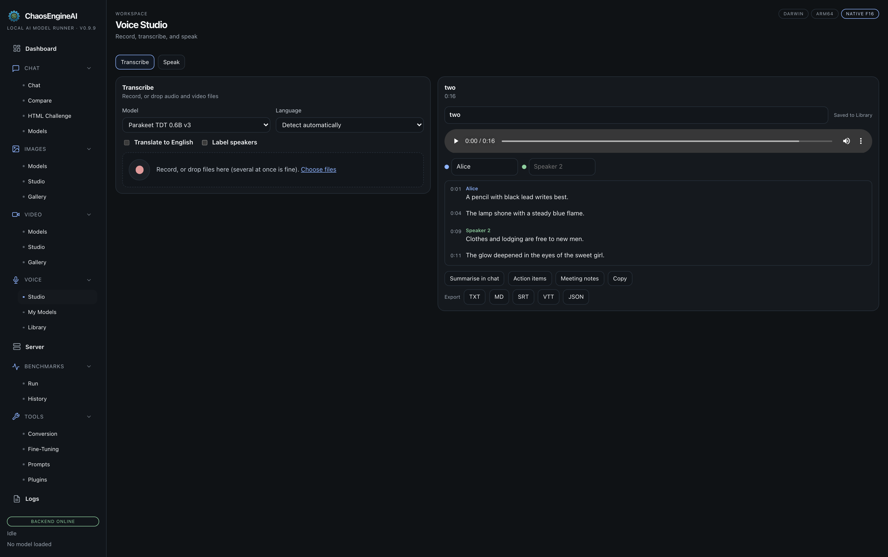

# Voice

Voice in ChaosEngineAI runs on your machine; nothing is uploaded. It covers
dictation and read-aloud in Chat, voice calls with the loaded model, and Voice
Studio for transcribing and speaking files.

## Install the voice pack

Install the voice pack once from **Voice > Models** (about 2 GB, plus the
models you choose). It lives in its own folder, so it cannot disturb the rest
of the app. The same page lists the speech-recognition models, lets you pick
the one used for dictation, and previews the Kokoro voices that chat reads
aloud with.

| | Speech recognition | Speech |
|---|---|---|
| **Apple Silicon** | Parakeet (25 European languages, the fastest), Nemotron 3.5 (40 languages, detects the language by itself) or Whisper (99 languages) | Kokoro |
| **Windows and Linux** | Whisper through faster-whisper | Kokoro |

Voice on Windows and Linux is new and has had less testing than on the Mac.
Please report anything that does not work.

The first time you use the microphone, macOS asks for permission.

## In Chat

- **Dictation.** The microphone button in the composer.
- **Read-aloud.** A speaker button on every reply, or have replies read
  automatically.
- **Voice calls.** Press **Call** and talk. The app hears when you stop, the
  model answers out loud, and you can talk over it to interrupt. Every turn is
  saved in the chat. An (i) next to Call lists anything still missing.

## Voice Studio

**Transcribe** takes a recording or audio and video files in a queue, with
speaker labels and translation to English. Edit the transcript, click a word
to jump to it in the audio, rename speakers, then export TXT, Markdown, SRT,
VTT or JSON, or send it to a chat.

**Speak** turns long text into speech, with pauses and voice previews, saved
as WAV or MP3.

## Voice Library

The Voice Library keeps every recording, transcript and generated clip. Items
from the old Gallery move over the first time you open it.
