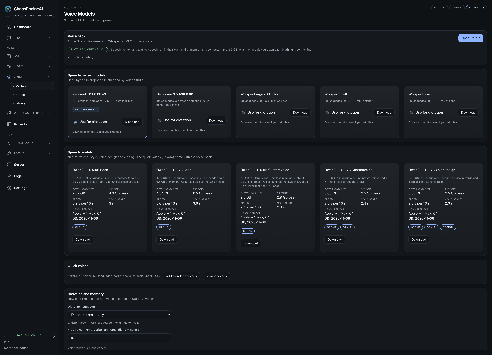
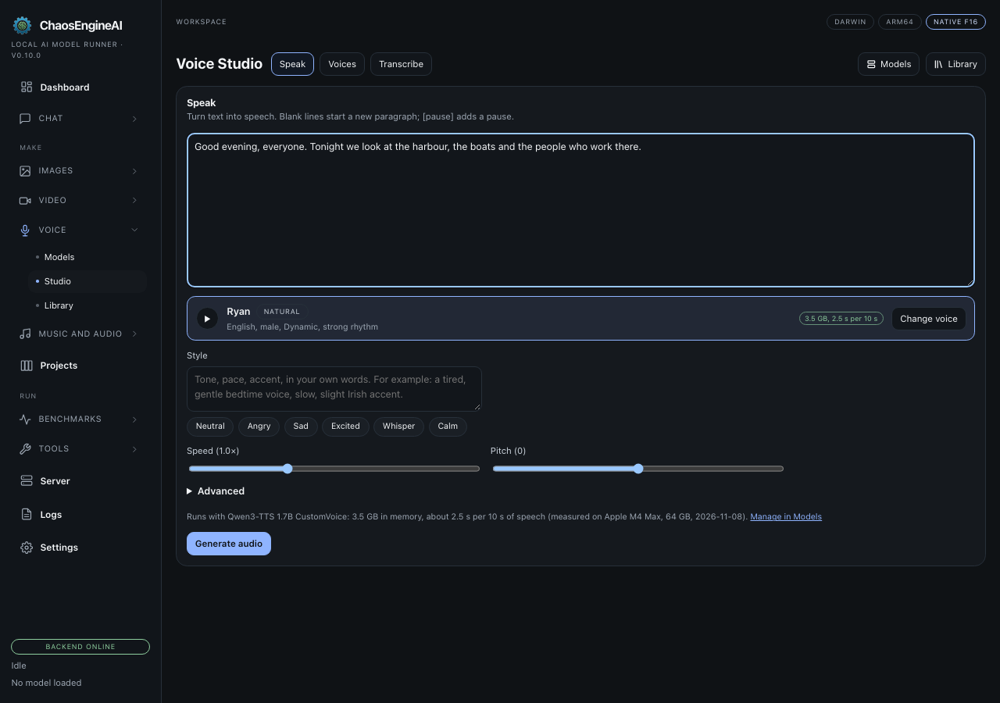

# Voice

Voice in ChaosEngineAI runs on your machine; nothing is uploaded. It covers
dictation and read-aloud in Chat, voice calls with the loaded model, and Voice
Studio for transcribing and speaking files.

## Install the voice pack

Install the voice pack once from **Voice > Models** (about 2 GB, plus the
models you choose). It lives in its own folder, so it cannot disturb the rest
of the app. The same page lists the speech-recognition models, lets you pick
the one used for dictation, and previews the Kokoro voices that chat reads
aloud with.

| | Speech recognition | Speech |
|---|---|---|
| **Apple Silicon** | Parakeet (25 European languages, the fastest), Nemotron 3.5 (40 languages, detects the language by itself) or Whisper (99 languages) | Kokoro |
| **Windows and Linux** | Whisper through faster-whisper | Kokoro |

Voice on Windows and Linux is new and has had less testing than on the Mac.
Please report anything that does not work.

The first time you use the microphone, macOS asks for permission.

## In Chat

- **Dictation.** The microphone button in the composer.
- **Read-aloud.** A speaker button on every reply, or have replies read
  automatically.
- **Voice calls.** Press **Call** and talk. The app hears when you stop, the
  model answers out loud, and you can talk over it to interrupt. Every turn is
  saved in the chat. An (i) next to Call lists anything still missing.

## Voice Studio

**Transcribe** takes a recording or audio and video files in a queue, with
speaker labels and translation to English. Edit the transcript, click a word
to jump to it in the audio, rename speakers, then export TXT, Markdown, SRT,
VTT or JSON, or send it to a chat.

**Speak** turns long text into speech, with pauses and voice previews, saved
as WAV or MP3.

### Clone a voice

Voice Studio > **Clone** makes a voice from your own voice, or from someone
who has given you permission. Apple Silicon Macs only for now. It uses
Qwen3-TTS Base (0.6B is faster, 1.7B closer; Apache 2.0), downloaded from
the same tab.

1. Click **New cloned voice**, choose whose voice it is and type the
   speaker's name. Public figures, children and people who have died are not
   allowed.
2. Add a voice sample: 3 to 30 seconds of the same person speaking clearly
   (10 to 20 seconds works best). Upload a WAV, MP3, M4A, FLAC or OGG file,
   or record it with the microphone.
3. Tick "This is my own voice, or the speaker has given me permission to
   clone it." and click **Save voice**.

The permission record (speaker's name, own voice or permission, date, a hash
of the sample, app version) is kept with the voice. **Delete** removes the
voice, its sample and the record. There is no import from web links and there
are no celebrity voices.

Every clip made with a cloned voice is saved to the Voice Library, labelled
as AI-made inside the file (WAV and MP3), and carries an inaudible watermark
(Meta's AudioSeal, MIT). Neither can be
turned off; the watermark component (about 100 MB) installs with the cloning
model, and cloned speech is refused without it.
A local log, `~/.chaosengine/voice/clone-audit.jsonl`, records when voices
are made, used and deleted (ids, hashes and lengths, never the text); it is
never uploaded.

Agents (the agent bridge) and other computers cannot use cloned voices unless
you tick **Allow agents and other computers to use cloned voices**, which only
this window can change. Agents can never make a new cloned voice, and each
time they speak with one they must confirm that the speaker's permission
covers that use; the confirmation goes into the local log.

## Voice Library

The Voice Library keeps every recording, transcript and generated clip. Items
from the old Gallery move over the first time you open it.
